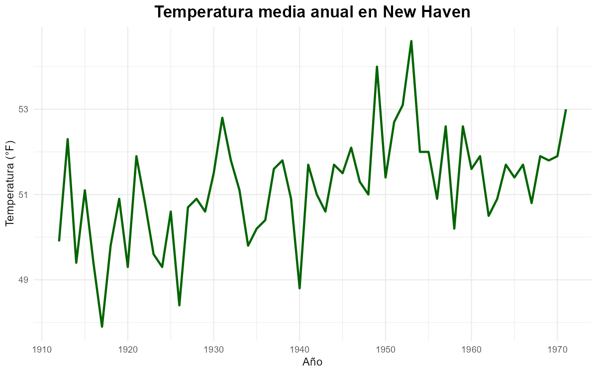
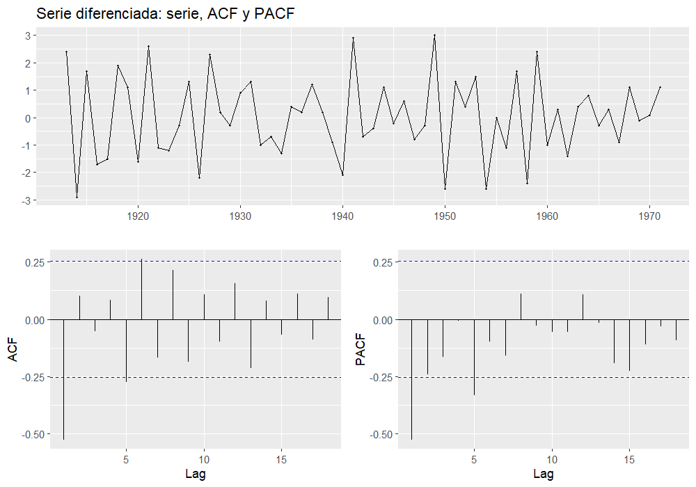
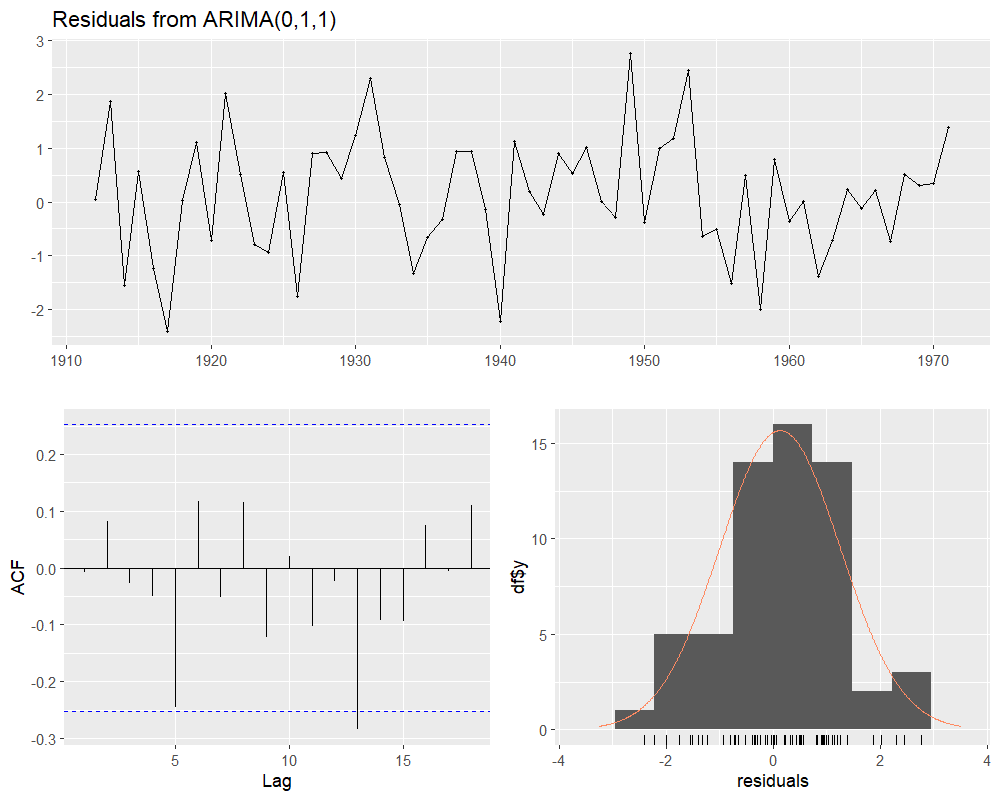
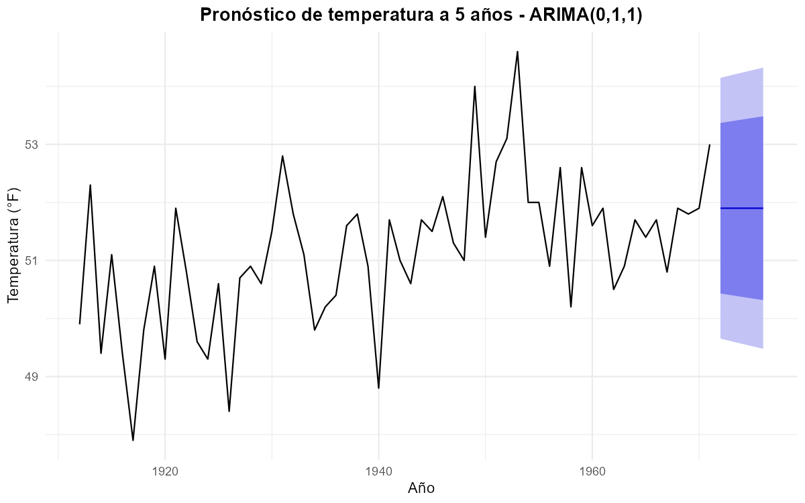
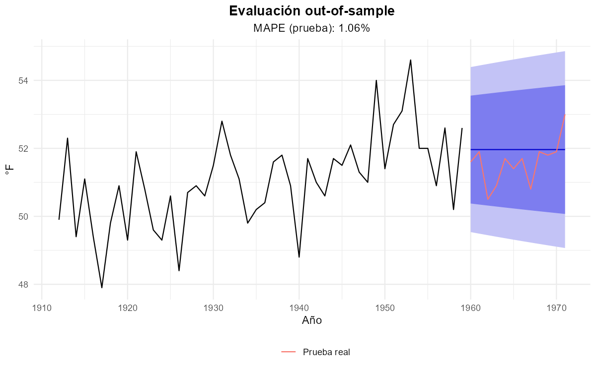
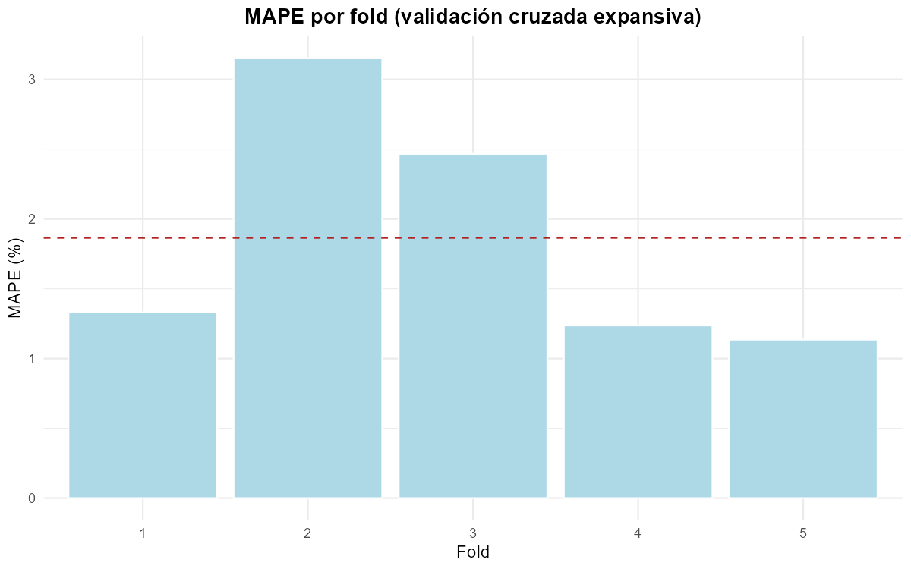
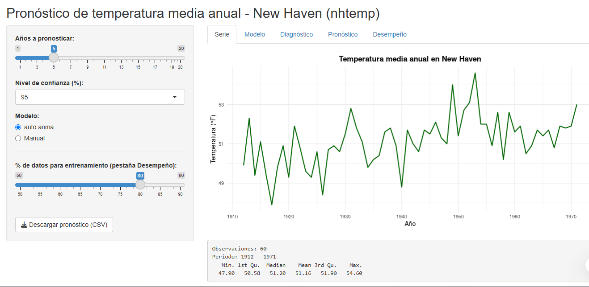

# Pronóstico de temperatura media anual – New Haven (nhtemp)

Proyecto de series de tiempo en R: análisis exploratorio, modelación ARIMA,
diagnóstico de residuales, evaluación del pronóstico y una app Shiny.

## Datos
Serie `nhtemp` (incluida en R): temperatura media anual en °F en New Haven,
Connecticut, de 1912 a 1971 (60 observaciones). No requiere archivos externos.

La serie es **anual** (frecuencia 1), por lo que no tiene componente estacional y
se modela con un **ARIMA(p,d,q)** y no con un SARIMA.

## Contenido
- `analisis_nhtemp.R`: análisis completo
  - Exploración y prueba de Levene (homogeneidad de varianzas)
  - Estacionariedad (Dickey-Fuller), ACF y PACF
  - Selección del modelo por AIC/BIC y comparación con `auto.arima()`
  - Diagnóstico de residuales (Ljung-Box, Shapiro-Wilk, Lilliefors, Jarque-Bera)
  - Pronóstico con intervalos de confianza
  - Desempeño: trayectoria ajustada, partición 80/20 y validación cruzada expansiva
- `app.R`: aplicación Shiny para explorar la serie, el modelo, el diagnóstico y los pronósticos.
- `img/`: gráficos generados por el script.
- `tabla_modelos.csv` y `pronostico_nhtemp.csv`: tablas de salida.

## Cómo ejecutar
1. Instalar R y los paquetes:
   ```r
   install.packages(c("forecast", "tseries", "nortest", "car", "ggplot2", "gridExtra", "shiny"))
   ```
2. Análisis (desde la terminal de R, con la carpeta del proyecto como directorio de trabajo):
   ```r
   source("analisis_nhtemp.R", echo = TRUE)
   ```
3. App:
   ```r
   shiny::runApp()
   ```

## Resultados principales
- **Varianza:** homogénea (Levene p = 0.734), no se requiere transformación Box-Cox.
- **Estacionariedad:** la serie no es estacionaria (ADF p = 0.084); `ndiffs()` sugiere d = 1.
- **Modelo elegido:** ARIMA(0,1,1), seleccionado por BIC y coincidente con `auto.arima`.
  Coeficiente MA(1) = -0.798 (error estándar 0.096), equivalente a un suavizamiento
  exponencial simple con α ≈ 0.20.
- **Diagnóstico:** residuales sin autocorrelación (Ljung-Box p = 0.541), normales
  (Shapiro p = 0.820, Lilliefors p = 0.831, Jarque-Bera p = 0.965) y con varianza
  constante (Levene p = 0.508).
- **Pronóstico 1972-1976:** 51.90 °F por año, con IC 95 % de [49.65, 54.15] en 1972
  a [49.48, 54.32] en 1976.
- **Desempeño:** MAPE en prueba (80/20) = 1.06 %; MAPE medio en validación cruzada
  expansiva = 1.86 % (desv. est. 0.90 %).
- **Limitación:** el pronóstico es constante porque el modelo no incluye tendencia, y su
  comportamiento es parecido al de un pronóstico ingenuo (Theil's U ≈ 0.99). La banda
  de incertidumbre crece con el horizonte, por lo que conviene usarlo a corto plazo.

## Gráficos

### Serie original


### ACF y PACF de la serie diferenciada


### Diagnóstico de residuales


### Pronóstico


### Evaluación con datos de prueba


### Validación cruzada


## App Shiny
Pestañas: Serie, Modelo, Diagnóstico, Pronóstico y Desempeño. Permite elegir el
horizonte, el nivel de confianza, el modelo (automático o manual) y el porcentaje
de datos de entrenamiento.

<!-- Cuando tengas la captura, agrega:  -->
